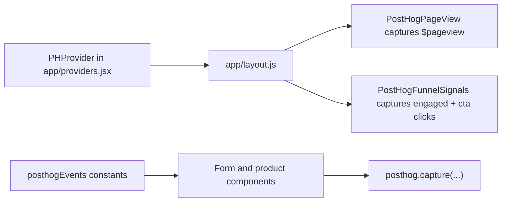

# PostHog Framework

This document is the source of truth for analytics tracking in this codebase.
Use it when adding, changing, or debugging PostHog instrumentation.

## 1) Where PostHog Lives

### Initialization and Provider
- `app/providers.jsx`
  - Initializes PostHog with `posthog.init(...)`.
  - Uses `capture_pageview: false` so pageviews are explicitly controlled.
  - Wraps app with `PostHogProvider`.

### Global Mounting
- `app/layout.js`
  - Mounts:
    - `components/PostHogPageViews.js` for `$pageview`.
    - `components/PostHogFunnelSignals.jsx` for engagement and CTA click signals.

### Event Registry
- `assets/utils/posthogEvents.js`
  - Central event constant map. Always add new custom event names here first.

### Feature Instrumentation
- `components/Contact.jsx`
  - Tracks `quote:form_started` on first form interaction.
- `components/sauna/ProductContactForm.jsx`
  - Tracks `quote:form_started` on first interaction.
  - Tracks `quote:form_submitted` on successful submit.
- `components/sauna/SaunaProductClient.jsx`
  - Tracks product view, installation choice, delivery state, and price recalculation.
- `components/sauna/ProductConfigurator.jsx`
  - Tracks size and config option selections.
- `components/sauna/PriceSummary.jsx`
  - Tracks add-to-cart intent as a config option event.

### Legacy/Alternative Helper
- `lib/usePosthogPageViews.js`
  - Hook-based pageview capture helper (`$pageview`).
  - Keep only if you intentionally use this hook elsewhere.

## 2) Tracking Architecture



## 3) Naming Convention

Use `domain:action` event names (low ambiguity, easy filtering):

- `product:product_viewed`
- `config:option_selected`
- `engagement:engaged`
- `cta:clicked`
- `quote:form_started`
- `quote:form_submitted`

Rules:
- Keep names stable once used in funnels/dashboards.
- Prefer broad reusable actions over overly specific names.
- Add every new event to `assets/utils/posthogEvents.js`.

## 4) Current Event Catalog

## Browsing and engagement
- `product:product_viewed`
  - Trigger: PDP product mount/view.
  - Typical properties: `productId`, `type`, `name`.
- `engagement:engaged`
  - Trigger: first 50% scroll depth on a route.
  - Properties: `page`, `scroll_depth`, `source`.

## CTA and quote intent
- `cta:clicked`
  - Trigger: click on links matching `/quote*` (delegated globally).
  - Properties: `page`, `cta_text`, `cta_href`, `cta_location`.
- `quote:form_started`
  - Trigger: first focus/input on quote forms.
  - Properties: `page`, `form_id`, optional `productId`.
- `quote:form_submitted`
  - Trigger: successful quote form submission.
  - Properties: `productId`, `totalPrice`, `installation`, `deliveryApplied`.

## Configurator and pricing
- `config:size_selected`
  - Properties: `productId`, `sizeKey`, `sizeLabel`.
- `config:option_selected`
  - Properties vary by option type (`wood`, `stove`, `addon`, `add_to_cart`).
- `config:installation_selected`
  - Properties: `productId`, `installation`.
- `config:delivery_applied`
  - Properties: `productId`, `applied`, `cost`.
- `config:price_recalculated`
  - Properties: `productId`, `totalPrice`, `basePrice`, `numAddons`, `installation`.

## 5) Implementation Recipes

### A) Add a new event safely
1. Add constant to `assets/utils/posthogEvents.js`.
2. Import `posthog` and `posthogEvents` in target component.
3. Capture with stable properties only.
4. Wrap capture in `try/catch` so analytics failures never break UX.

Example:

```jsx
try {
  posthog.capture(posthogEvents.some_new_event, {
    page: pathname || window.location.pathname,
    form_id: "quote-contact-form",
  });
} catch {}
```

### B) Prevent duplicate events
- For first-action events, use a `useRef(false)` guard.
- For per-route events, reset ref when `pathname` changes.
- For repeated CTAs, prefer delegated listeners at a global mount point.

### C) Property design guidance
- Keep default properties low-cardinality:
  - Good: `form_id`, `cta_location`, `installation`.
  - Avoid by default: long free text, full objects, raw user input.
- Include `page` when event can happen in multiple places.

## 6) Funnel Playbook (Recommended)

Default quote funnel:
1. `engagement:engaged`
2. `cta:clicked`
3. `quote:form_started`
4. `quote:form_submitted`

Recommended breakdowns:
- `page`
- `cta_location`
- `form_id`

Recommended conversion windows:
- Start with same session.
- Expand to 1 day for slower purchase journeys.

## 7) Debugging and QA Checklist

Before shipping instrumentation:
- Confirm event appears in PostHog Live Events.
- Confirm event count is not duplicated from rerenders.
- Validate required properties exist and values are sane.
- Validate route changes still trigger expected events.
- Verify existing events still fire after your change.

When funnel numbers look wrong:
- Check for duplicate fires from multiple listeners.
- Check dropped steps from missing properties or inconsistent naming.
- Check whether high-cardinality properties are fragmenting analysis.

## 8) Governance Rules

- Never hardcode ad-hoc event name strings in feature files.
- Always use `posthogEvents` constants.
- Keep event semantics stable (do not repurpose old event names).
- Update this file whenever event meanings or required properties change.

## 9) Practical Framework Insight

Think of tracking in three layers:
- **Intent signals**: user is moving toward conversion (`cta:clicked`, `quote:form_started`).
- **Outcome signals**: user completed an important action (`quote:form_submitted`).
- **Context signals**: what shaped behavior (`installation`, `cta_location`, `page`).

This separation makes it easier to answer:
- Where people drop off in the funnel.
- Which CTA placements drive qualified starts.
- Whether form starts convert differently by product context.

Current scope note:
- Cold plunge tracking expansion is intentionally deferred for now.
